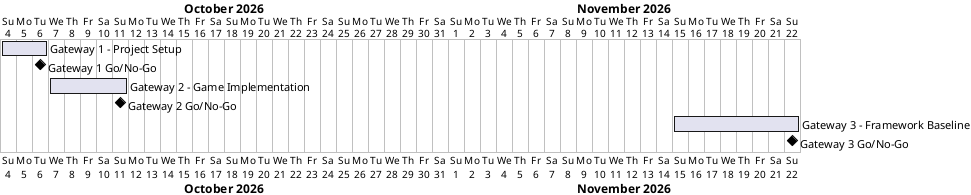

# Project Plan

## Metadata
| Key | Value |
| --- | --- |
| ID | PP-001 |
| CrossReference | [BC-001], [SA-001], [MIL-001], [MIL-002], [MIL-003] |
| Language | en |
| Domain | education |

## Version History
| Date | Status | Author | Reviewer | Change | Commit |
| --- | --- | --- | --- | --- | --- |
| 2026-10-04 | Accepted | Jens Tirsvad Nielsen | S01 | Initial version | [1d35410] |
| 2026-11-15 | Accepted | Jens Tirsvad Nielsen | AI as stand-in for S01 | Added the baseline gateway MIL-003, its scope coverage, dependency, risk and Gantt rows; sources on the assumptions; the Language and Domain metadata; refreshed the open issues; reviewed in autonomous mode, not independent | [11c811b] |

---

## Purpose

Schedule the two gateways that deliver the Blackjack game within the Business Case's two-evening effort constraint ([BC-001]). A third gateway, [MIL-003], was added on 2026-11-15 to bring the finished project to the baseline of the framework, within the one-week constraint of [BC-001].

## Planning Assumptions

- Week 1 starts 2026-10-04; the plan ends by 2026-10-11 (source: [BC-001], Constraints).
- The baseline gateway [MIL-003] starts 2026-11-15 and ends by 2026-11-22, one week (source: [BC-001], Constraints). The end date of the plan moves from 2026-10-11 to 2026-11-22 because of it; the reason is the agreed minimum quality baseline of the framework.
- Phase length: setup 2 days, implementation 5 days (part-time), baseline 7 days (source: [BC-001], Scope).
- Communication follows [SA-001]: one pull request review by S01 per gateway; S02 and S03 are served by the published repository. For the baseline gateway the review is done by an AI stand-in for S01 (source: [SA-001], Conflicting Interests).
- Product Owner language is English and the domain is education; no translated copies of the documents are kept (source: `docs/artifact-registry.md`).

## Gateway Schedule

| Gateway | Document | Window | Decision date | Owner | Stories | Main deliverable | Milestone |
| --- | --- | --- | --- | --- | --- | --- | --- |
| Gateway 1 - Project Setup | [MIL-001] | 2026-10-04 to 2026-10-06 | 2026-10-06 | S01 | none | Layout, pyproject, constants, Doxyfile, README | [Milestone-34] |
| Gateway 2 - Game Implementation | [MIL-002] | 2026-10-07 to 2026-10-11 | 2026-10-11 | S01 | none | Playable, tested, documented game | [Milestone-35] |
| Gateway 3 - Framework Baseline | [MIL-003] | 2026-11-15 to 2026-11-22 | 2026-11-22 | S01 | none (documentation and technical tasks) | The framework release, the wiki in three languages, the README, the licence metadata, the traceability matrix and the review records | [Milestone-510] |



## Scope Coverage

| Business Case scope item | Gateway |
| --- | --- |
| Project scaffolding and README | [MIL-001] |
| Git host description and topics | [MIL-001] |
| Game logic, emoji cards, logo, restart | [MIL-002] |
| Unit tests | [MIL-002] (smoke test in [MIL-001]) |
| Doxygen documentation | [MIL-001] (Doxyfile), [MIL-002] (comments) |
| The baseline phase: framework release, wiki, README template, licence metadata, traceability matrix, review records | [MIL-003] |

## Dependencies

```
Gateway 1 - Project Setup -> Gateway 2 - Game Implementation -> Gateway 3 - Framework Baseline
```

A No-Go on Gateway 1 moves every Gateway 2 and Gateway 3 date by the same number of days. A No-Go on Gateway 2 moves Gateway 3 and the end date of the plan by the time needed to fix the failed criterion. A No-Go on Gateway 3 moves the end date; S01 decides the new date.

## Plan Risks

| Risk | Impact | Mitigation |
| --- | --- | --- |
| Part-time availability | Dates slip | Dates are targets; a slip is recorded here, scope is not cut |
| Git host API token lacks permission to edit repository metadata | Task 1 of Gateway 1 blocked | Set description and topics by hand in the web UI |
| A CI (continuous integration) check fails on the pull request of [MIL-003] | The merge is delayed past 2026-11-22 | The failure is fixed on the same branch and the checks run again; after three failed rounds on one cause the work stops and S01 decides (trace: [BC-001], Risks) |

## Open Issues

- No use cases or user stories are modelled: all tasks are plain technical tasks because the assignment is a small single-actor console program. Say if a use case (for example "Play a game of Blackjack") should be added first.
- The reviewer for every artifact is S01 (the Product Owner); for the baseline gateway an AI stand-in reviews, and an independent reviewer would need a new stakeholder ID.
- The Python `.gitignore` already exists in the repository and is verified in [MIL-001] task 2.
- The existing source and tests are not reviewed against the Python QC checklist; a later milestone would plan that review.
- The published wiki is checked on the git host after the merge, because the host copies it only then.

---

[Milestone-510]: https://git.tirsystem.com/Tirsvad-Udemy-100-days-of-code/011-blackjack/milestone/510
[MIL-003]: ./milestones/mil-003-framework-baseline.md
[BC-001]: ./business-case.md
[SA-001]: ./stakeholder-analysis.md
[MIL-001]: ./milestones/mil-001-project-setup.md
[MIL-002]: ./milestones/mil-002-game-implementation.md
[Milestone-34]: https://git.tirsystem.com/Tirsvad-Udemy-100-days-of-code/011-blackjack/milestone/34
[Milestone-35]: https://git.tirsystem.com/Tirsvad-Udemy-100-days-of-code/011-blackjack/milestone/35
[1d35410]: https://git.tirsystem.com/Tirsvad-Udemy-100-days-of-code/011-blackjack/commit/1d35410b8d29df6c4991a0b9aff24f8509d58a86
[11c811b]: https://git.tirsystem.com/Tirsvad-Udemy-100-days-of-code/011-blackjack/commit/11c811bf713454e183db31fb0ebb0965614bd3bf
